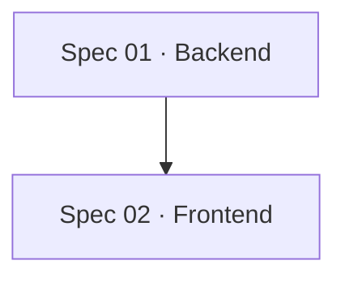

# Specs de <Módulo> (`<módulo>`) — StartBig

> **Modelo.** Copie esta pasta para `specs/{módulo}/`, troque os `<marcadores>` e apague esta nota. Crie também `completed/` (com um `.gitkeep`).

Resumo de uma ou duas linhas do que o módulo cobre e onde o código vive (`frontend/src/modules/<módulo>/` e as pastas de domínio do backend).

## 1. Mapa das specs

| Spec | Arquivo | Camada | Situação | O que entrega |
|------|---------|--------|----------|---------------|
| <MÓD>-01 | [`SPEC-01-TEMA-MODULO.md`](./SPEC-01-TEMA-MODULO.md) | Backend | Backlog | <Entrega em uma linha> |
| <MÓD>-02 | [`SPEC-02-TEMA-MODULO.md`](./SPEC-02-TEMA-MODULO.md) | Frontend | Backlog | <Entrega em uma linha> |

> Spec concluída: o link passa a ser `./completed/SPEC-NN-....md` e a situação, `Concluída (AAAA-MM-DD)`.

## 2. Dependências

Ordem de implementação recomendada e o motivo. Dependências **entre módulos** apontam para a spec do outro módulo.

## 3. Roteamento por tarefa

| Preciso... | Spec | Seção |
|------------|------|-------|
| <Criar/alterar tal comportamento> | <MÓD>-01 | §6.2 |

## 4. Roteamento por arquivo

| Arquivo | Spec que o define ou altera |
|---------|------------------------------|
| `backend-fastapi/app/services/<domínio>/<arquivo>.py` | <MÓD>-01 |
| `frontend/src/modules/<módulo>/views/<Tela>View.vue` | <MÓD>-02 |

## 5. Endpoints

| Método e rota | Permissão | Spec |
|---------------|-----------|------|
| `GET /api/v1/<recurso>/` | `<permissão>` | <MÓD>-01 §4 |

### Rotas do frontend

| Rota | Tela | Spec |
|------|------|------|
| `/<rota>` | `<Tela>View` | <MÓD>-02 |

## 6. Referências

- Acordo de decisões: [`docs/<módulo>/ACORDO.md`](../../docs/<módulo>/ACORDO.md)
- ADRs: [`docs/<módulo>/adr/`](../../docs/<módulo>/adr/)
- Design de referência: <arquivo ou link>
