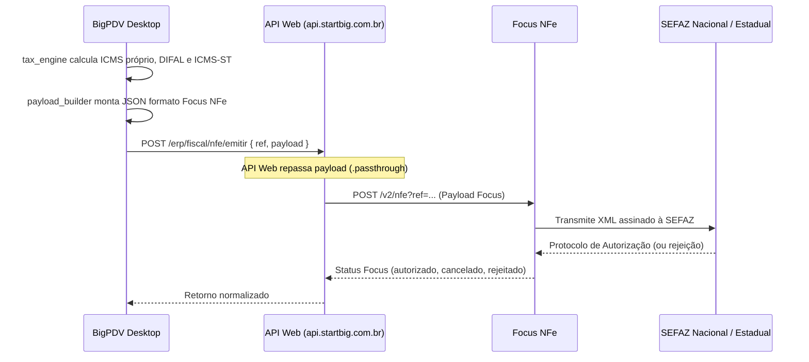

# SPEC 6 — Payload Interestadual (Focus NFe / API StartBig Web) e Interface

## 1. Objetivo

Ajustar a geração do payload JSON de emissão de NF-e em [`payload_builder.py`](file:///c:/dev/bigpdv/backend-fastapi/app/services/fiscal/payload_builder.py) para incluir todos os nós e campos necessários em operações interestaduais (DIFAL/FCP e ICMS-ST), utilizando **estritamente a nomenclatura canônica da API Focus NFe**. 

Dessa forma, a API intermediária na web (`api.startbig.com.br`) poderá repassar o payload diretamente para a Focus via `.passthrough()`, sem retrabalho, sem atrito de mapeamento e sem perdas de campos no Zod.

Além disso, a spec define os **guardrails de pré-validação** (evitando queimar numeração na SEFAZ) e a **sinalização visual no Checkout/PDV**, avisando ao operador que a venda interestadual possui incidência tributária diferenciada antes da finalização.

---

## 2. Contexto: A Esteira Desktop → API Web StartBig → Focus NFe → SEFAZ

### 2.1. O Fluxo de Comunicação



### 2.2. Por que a Nomenclatura Rigorosa é Crítica?

Conforme documentado em [`docs/contrato-api-fiscal-plataforma.md`](file:///c:/dev/bigpdv/backend-fastapi/docs/contrato-api-fiscal-plataforma.md):
- A API StartBig Web atua como uma integradora/proxy autenticada com a Focus NFe.
- Se o Desktop usar nomes arbitrários (ou tags puras do XML como `<vBCST>`), a API Web teria que implementar um conversor complexo de DTOs para cada campo.
- Ao usar os **nomes exatos que a Focus NFe espera em snake_case**, a API Web apenas valida o token da licença e repassa o corpo da requisição. Isso garante **zero atrito**, máxima manutenibilidade e previne que atualizações futuras quebrem a comunicação.

---

## 3. Dicionário de Nomenclaturas Focus NFe (Zero Atrito)

Abaixo está o mapeamento exato entre a tag da SEFAZ, o DTO do `tax_engine` do BigPDV e o campo JSON a ser gerado para a Focus NFe:

### 3.1. Campos de DIFAL / Partilha no Item (`items[]`)

| Tag XML SEFAZ | DTO BigPDV (`ImpostosItem`) | Campo JSON Focus NFe | Tipo | Exemplo |
|---|---|---|---|---|
| `<vBCUFDest>` | `difal_base_calculo` | `base_calculo_uf_destino` | Float | `1000.0` |
| `<pFCPUFDest>` | `fcp_aliquota` | `percentual_fcp_uf_destino` | Float | `2.0` |
| `<pICMSUFDest>` | `difal_aliquota_interna_destino` | `aliquota_interna_uf_destino` | Float | `18.0` |
| `<pICMSInter>` | `difal_aliquota_interestadual` | `aliquota_interestadual` | Float | `12.0` |
| `<vFCPUFDest>` | `fcp_valor` | `valor_fcp_uf_destino` | Float | `20.0` |
| `<vICMSUFDest>` | `difal_valor` | `valor_icms_interestadual_uf_destino` | Float | `60.0` |
| `<vICMSUFRemet>` | `difal_valor_remetente` | `valor_icms_interestadual_uf_remetente`| Float | `0.0` |
| `<vBCFCPUFDest>` | `fcp_base_calculo` | `base_calculo_fcp_uf_destino` | Float | `1000.0` |

### 3.2. Campos de ICMS-ST no Item (`items[]`)

| Tag XML SEFAZ | DTO BigPDV (`ImpostosItem`) | Campo JSON Focus NFe | Tipo | Exemplo |
|---|---|---|---|---|
| `<modBCST>` | `icms_st_modalidade_base_calculo` | `icms_modalidade_base_calculo_st` | Integer | `4` (MVA) |
| `<pMVAST>` | `icms_st_mva` | `icms_margem_valor_adicionado_st` | Float | `40.0` |
| `<pRedBCST>` | `icms_st_reducao_base` | `icms_reducao_base_calculo_st` | Float | `20.0` |
| `<vBCST>` | `icms_st_base_calculo` | `icms_base_calculo_st` | Float | `1400.0` |
| `<pICMSST>` | `icms_st_aliquota` | `icms_aliquota_st` | Float | `18.0` |
| `<vICMSST>` | `icms_st_valor` | `icms_valor_st` | Float | `132.0` |

### 3.3. Campos de Totais no Cabeçalho (`totais`)

| Tag XML SEFAZ | DTO BigPDV (`TotaisNota`) | Campo JSON Focus NFe | Tipo | Exemplo |
|---|---|---|---|---|
| `<vBCST>` | `base_calculo_icms_st` | `icms_base_calculo_st` | Float | `1400.0` |
| `<vST>` | `valor_icms_st` | `icms_valor_total_st` | Float | `132.0` |
| `<vFCPUFDest>` | `valor_fcp` | `valor_fcp_uf_destino` | Float | `20.0` |
| `<vICMSUFDest>`| `valor_difal` | `valor_icms_uf_destino` | Float | `60.0` |
| `<vNF>` | `valor_total_nota` | `valor_total` | Float | `1132.0` (já somado o ST) |

---

## 4. Detalhamento das Alterações no `payload_builder.py`

**Arquivo**: [`app/services/fiscal/payload_builder.py`](file:///c:/dev/bigpdv/backend-fastapi/app/services/fiscal/payload_builder.py)

### 4.1. Dinamização de `local_destino` (`idDest`)

Atualmente fixado na linha 721 como:
```python
"local_destino": 1,
```

**Alteração**:
```python
# idDest: 1 = Operação interna, 2 = Operação interestadual
# Determinado pela UF de destino vs UF emitente e pelo tipo de operação
is_presencial = indicador_presenca == 1
is_mesma_uf = True
if venda.cliente and venda.cliente.endereco:
    uf_dest = venda.cliente.endereco[0].estado
    uf_dest_str = uf_dest.value if hasattr(uf_dest, "value") else str(uf_dest)
    uf_emit_str = endereco_empresa.estado.value if hasattr(endereco_empresa.estado, "value") else str(endereco_empresa.estado)
    if uf_dest_str.upper() != uf_emit_str.upper():
        is_mesma_uf = False

local_destino = 1 if (is_presencial or is_mesma_uf) else 2
```

O payload recebe:
```python
"local_destino": local_destino,
```

### 4.2. Injeção dos Dados Tributários de DIFAL no Item

Na função `_montar_itens`, dentro do bloco `if imp:` (onde já se preenchem os dados de ICMS, PIS e COFINS):

```python
# Injeção de DIFAL / Partilha ICMSUFDest (SPEC 4)
if imp.difal_aliquota_interestadual is not None and imp.difal_valor is not None:
    item_dict.update({
        "base_calculo_uf_destino": float(imp.difal_base_calculo),
        "aliquota_interna_uf_destino": float(imp.difal_aliquota_interna_destino),
        "aliquota_interestadual": float(imp.difal_aliquota_interestadual),
        "valor_icms_interestadual_uf_destino": float(imp.difal_valor),
        "valor_icms_interestadual_uf_remetente": float(imp.difal_valor_remetente or Decimal("0")),
    })
    if imp.fcp_aliquota and imp.fcp_aliquota > Decimal("0"):
        item_dict.update({
            "base_calculo_fcp_uf_destino": float(imp.fcp_base_calculo or imp.difal_base_calculo),
            "percentual_fcp_uf_destino": float(imp.fcp_aliquota),
            "valor_fcp_uf_destino": float(imp.fcp_valor or Decimal("0")),
        })
```

### 4.3. Injeção dos Dados Tributários de ICMS-ST no Item

Logo em seguida, dentro da mesma função `_montar_itens`:

```python
# Injeção de ICMS-ST (SPEC 5)
if imp.icms_st_valor is not None and imp.icms_st_base_calculo is not None:
    item_dict.update({
        "icms_modalidade_base_calculo_st": imp.icms_st_modalidade_base_calculo,
        "icms_base_calculo_st": float(imp.icms_st_base_calculo),
        "icms_aliquota_st": float(imp.icms_st_aliquota or Decimal("0")),
        "icms_valor_st": float(imp.icms_st_valor),
        "icms_margem_valor_adicionado_st": float(imp.icms_st_mva or Decimal("0")),
    })
    if imp.icms_st_reducao_base and imp.icms_st_reducao_base > Decimal("0"):
        item_dict["icms_reducao_base_calculo_st"] = float(imp.icms_st_reducao_base)
```

### 4.4. Atualização dos Totais no Cabeçalho

Na função `_montar_totais_pagamentos`, garantir que quando `resultado_calculo` estiver presente:

```python
totais = {
    "valor_produtos": float(t.valor_total_produtos),
    "valor_frete": float(t.valor_frete),
    "valor_seguro": float(t.valor_seguro),
    "valor_outras_despesas": float(t.valor_outras_despesas),
    "valor_desconto": float(t.valor_desconto),
    "icms_base_calculo": float(t.base_calculo_icms),
    "icms_valor_total": float(t.valor_icms),
    "valor_total": float(t.valor_total_nota),
    # Totais de ST (quando houver)
    "icms_base_calculo_st": float(t.base_calculo_icms_st or Decimal("0")),
    "icms_valor_total_st": float(t.valor_icms_st or Decimal("0")),
    # Totais de DIFAL / FCP (quando houver)
    "valor_icms_uf_destino": float(t.valor_difal or Decimal("0")),
    "valor_fcp_uf_destino": float(t.valor_fcp or Decimal("0")),
}
```

A função [`expurgar_nulos`](file:///c:/dev/bigpdv/backend-fastapi/app/services/fiscal/payload_builder.py#L43) já descarta chaves com valores zerados caso a Focus prefira omissão, mas manter valores `0.0` para totais onde a Focus exige declaração explícita.

---

## 5. Guardrails e Pré-validações de Emissão

Adicionar validações no gate de emissão ([`app/services/fiscal/emissao.py`](file:///c:/dev/bigpdv/backend-fastapi/app/services/fiscal/emissao.py)) antes de reservar o número e antes de chamar o client HTTP:

1. **Guard de Inscrição Estadual para Contribuinte (`indIEDest == 1`)**:
   Se a operação for interestadual para contribuinte (`indIEDest == 1`), a Inscrição Estadual (`ie`) do cliente deve ser obrigatória e passar na validação de formato. Emitir com `ie` vazia para `indIEDest = 1` causa **Rejeição 232 da SEFAZ** e queima o número da nota.
   *Ação*: Lançar `HTTP 422 - "Cliente contribuinte exige Inscrição Estadual cadastrada para emissão interestadual"`.

2. **Guard de Endereço Completo do Destinatário**:
   A emissão interestadual é sempre rejeitada pela SEFAZ se faltar código IBGE do município de destino ou CEP.
   *Ação*: Validar que `logradouro`, `numero`, `bairro`, `cidade` e `cep` estejam preenchidos no destinatário.

3. **Guard de Consistência de CFOP x Destino**:
   Se `local_destino == 2` (interestadual), nenhum item pode conter CFOP iniciado por 5 (ex: `5102`), sob pena de Rejeição 523 da SEFAZ. O CFOP deve obrigatoriamente iniciar com 6 (ex: `6102`, `6108`, `6404`).

---

## 6. Sinalização Visual no Frontend (PDV / Checkout)

Para evitar surpresas no caixa e na frente de vendas:

### 6.1. Badge Informativo no Componente de Seleção de Cliente

No fechamento de venda / checkout do PDV:
- Se o cliente selecionado tiver endereço com UF diferente da UF da loja (e a venda for entrega/não presencial):
  - Se for **Não Contribuinte**: Exibir tag azul clara:
    $$\text{🏷️ Interestadual B2C (DIFAL)}$$
    *Tooltip*: "Operação interestadual sujeita a recolhimento de DIFAL para o estado de destino."
  - Se for **Contribuinte (com IE)**: Exibir tag roxa:
    $$\text{🏷️ Interestadual B2B (ICMS-ST / Revenda)}$$
    *Tooltip*: "Operação interestadual com contribuinte. Pode incidir retenção de ICMS-ST no valor final."

### 6.2. Discriminação dos Tributos no Resumo da Venda

Na gaveta de resumo de totais (ao lado do Subtotal, Frete e Desconto):
- Se houver `valor_icms_st > 0`: Exibir linha destacada:
  `(+) ICMS-ST Retido: R$ 132,00`
  *(Mostrando ao operador por que o total a cobrar é superior ao subtotal dos itens)*.
- Se houver `valor_difal > 0`: Exibir linha informativa:
  `DIFAL Destino (Incluso): R$ 60,00`
  *(Informativo, não altera o total da venda)*.

---

## 7. Critérios de Aceite

### CA-1: Aderência Estrita à Nomenclatura Focus NFe
- [ ] Os campos de DIFAL nos itens usam exatamente as chaves `aliquota_interestadual`, `aliquota_interna_uf_destino`, `percentual_fcp_uf_destino`, `valor_icms_interestadual_uf_destino`, `valor_fcp_uf_destino`, etc.
- [ ] Os campos de ST nos itens usam exatamente as chaves `icms_modalidade_base_calculo_st`, `icms_base_calculo_st`, `icms_aliquota_st`, `icms_valor_st`, `icms_margem_valor_adicionado_st`.
- [ ] Nenhuma tag XML crua (ex: `<vBCST>`) é emitida no JSON enviado para a API StartBig.
- [ ] A API StartBig Web consegue repassar o JSON diretamente para a Focus via `.passthrough()` sem qualquer erro de schema.

### CA-2: `local_destino` Dinâmico e Coerência de CFOP
- [ ] Vendas não presenciais para outras UFs geram `"local_destino": 2`.
- [ ] Vendas locais ou vendas de balcão presencial (mesmo com cliente de fora) mantêm `"local_destino": 1`.
- [ ] Quando `"local_destino": 2`, todos os CFOPs dos itens iniciam com o dígito 6.

### CA-3: Totais do Cabeçalho
- [ ] No caso de ICMS-ST, o totalizador `totais.icms_valor_total_st` reflete a soma exata dos itens e o `totais.valor_total` inclui o valor do ICMS-ST.
- [ ] No caso de DIFAL, `totais.valor_icms_uf_destino` reflete o montante apurado e `totais.valor_total` não sofre acréscimo indevido.

### CA-4: Guardrails Ativos
- [ ] Tentativa de emitir venda interestadual B2B para cliente com `indIEDest = 1` sem IE cadastrada é bloqueada com HTTP 422 antes de reservar numeração.
- [ ] Tentativa de emitir venda interestadual sem endereço completo do destinatário é bloqueada preventivamente.

### CA-5: Interface Visual no PDV
- [ ] Checkout exibe tags contextuais ("Interestadual B2C" ou "Interestadual B2B") assim que o cliente é vinculado.
- [ ] Totalizador de pagamento discrimina o ICMS-ST acrescido quando aplicável.
- [ ] Nenhuma quebra visual ocorre em vendas internas normais.


---

## Desvios aplicados (2026-09-19) — backend
Ver `docs/done/fiscal/TASK009.md`. Destaques: `local_destino` pelo grupo do CFOP calculado (mesma decisão do resolver); campos ST/DIFAL só quando existem (contrato exato da venda interna); guard da IE valida formato (Rejeição 232); endereço já era validado. **Pendência de negócio**: o total da venda do PDV precisa incluir a ST para fechar com o vNF. CA-5 (PDV) fica para a rodada de interface. 20 testes novos, gate 1063 passed.
