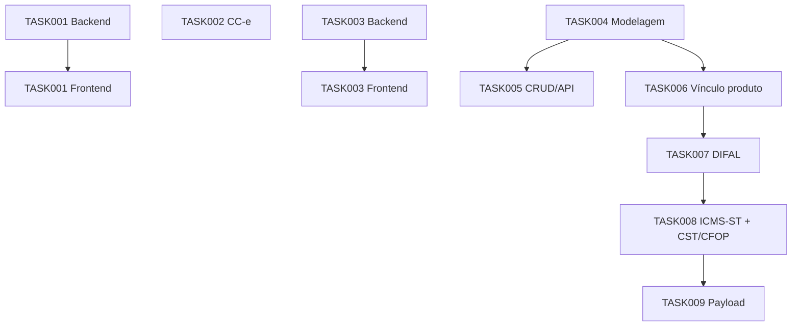

# Specs do Fiscal (`fiscal`) — StartBig

Specs das melhorias do Centro Fiscal (NF-e): trava de numeração, carta de correção, NF-e de devolução e emissão **interestadual** (perfil tributário, DIFAL, ICMS-ST e payload). Visão do módulo: [`docs/fiscal/README.md`](../../docs/fiscal/README.md). Decisões: [`docs/fiscal/adr/`](../../docs/fiscal/adr/). Histórico de execução de cada spec (commits, desvios, gates): [`docs/fiscal/archive/`](../../docs/fiscal/archive/README.md).

> **Nome dos arquivos:** estas specs nasceram com o prefixo `TASKnnn` (padrão antigo), não `SPEC-NN-TEMA-MODULO`. Foram **movidas sem renomear** para preservar as referências dos docs de progresso. Specs novas deste módulo seguem o padrão `SPEC-NN-TEMA-FISCAL.md` (skill `spec`).

## 1. Mapa das specs

| Spec | Arquivo | Camada | Situação | O que entrega |
|------|---------|--------|----------|---------------|
| TASK001-B | [`TASK001-BACKEND-LockerNumeracaoFiscal.md`](./completed/TASK001-BACKEND-LockerNumeracaoFiscal.md) | Backend | Concluída (2026-09-17) | Trava (locker) de numeração fiscal |
| TASK001-F | [`TASK001-FRONTEND-InterfaceConfirmacaoNumeroFiscal.md`](./completed/TASK001-FRONTEND-InterfaceConfirmacaoNumeroFiscal.md) | Frontend | Concluída (2026-09-17) | Interface de confirmação do número fiscal |
| TASK002 | [`TASK002-EmitirCartaCorrecao.md`](./completed/TASK002-EmitirCartaCorrecao.md) | Backend + Frontend | Concluída (2026-09-17) | Carta de correção eletrônica (CC-e) da NF-e |
| TASK003-B | [`TASK003-BACKEND-NotaDevolucao.md`](./completed/TASK003-BACKEND-NotaDevolucao.md) | Backend | Concluída (2026-09-17) | NF-e de devolução a partir do snapshot da nota |
| TASK003-F | [`TASK003-FRONTEND-NotaDevolucao.md`](./completed/TASK003-FRONTEND-NotaDevolucao.md) | Frontend | Concluída (2026-09-17) | Modal de devolução |
| TASK004 | [`TASK004 - MODELAGEM-BANCO-PERFIL-TRIBUTARIO.md`](./completed/TASK004%20-%20MODELAGEM-BANCO-PERFIL-TRIBUTARIO.md) | Backend | Concluída (2026-09-18) | Modelagem do perfil tributário e das regras por perfil |
| TASK005 | [`TASK005 - CRUD+API-REST-PERFIL-TRIBUTARIO.md`](./completed/TASK005%20-%20CRUD+API-REST-PERFIL-TRIBUTARIO.md) | Backend | Concluída (2026-09-18) | CRUD e API REST dos perfis tributários |
| TASK006 | [`TASK006 - VINCULO-PRODUTO-PERFIL-TRIBUTARIO.md`](./completed/TASK006%20-%20VINCULO-PRODUTO-PERFIL-TRIBUTARIO.md) | Backend | Concluída (2026-09-18) | Vínculo produto → perfil e resolvedor |
| TASK007 | [`TASK007 - MOTOR-DIFAL.md`](./completed/TASK007%20-%20MOTOR-DIFAL.md) | Backend | Concluída (2026-09-18) | Motor de cálculo do DIFAL e FCP |
| TASK008 | [`TASK008 - MOTOR-ICMS-ST+DERIVACAO-CST-CFOP-INTERESTADUAL.md`](./completed/TASK008%20-%20MOTOR-ICMS-ST+DERIVACAO-CST-CFOP-INTERESTADUAL.md) | Backend | Concluída (2026-09-19) | Motor de ICMS-ST e derivação de CST/CFOP interestadual |
| TASK009 | [`TASK009 - PAYLOAD-INTERESTADUAL-INTERFACE.md`](./completed/TASK009%20-%20PAYLOAD-INTERESTADUAL-INTERFACE.md) | Backend | Concluída (2026-09-19) | Payload interestadual (a parte de interface está descrita na própria spec) |

> As datas vêm dos docs de progresso em `docs/fiscal/archive/`. A situação "Concluída" é a registrada ali; confirme no código antes de tratar como verdade absoluta.

## 2. Dependências

Dois blocos independentes: **eventos e numeração** (TASK001 a 003) e **emissão interestadual** (TASK004 a 009). A ordem acima é a de execução registrada em `docs/fiscal/archive/README.md` e `README-interestadual.md`.

## 3. Roteamento por tarefa

| Preciso... | Spec | Doc de progresso |
|------------|------|------------------|
| Entender a trava de numeração | TASK001 | [`archive/TASK001-BACKEND.md`](../../docs/fiscal/archive/TASK001-BACKEND.md) |
| Mexer em carta de correção | TASK002 | [`archive/TASK002.md`](../../docs/fiscal/archive/TASK002.md) · [ADR-001](../../docs/fiscal/adr/ADR-001-eventos-fiscais-em-tabela-propria.md) |
| Mexer em nota de devolução | TASK003 | [`archive/TASK003-BACKEND.md`](../../docs/fiscal/archive/TASK003-BACKEND.md) · [ADR-002](../../docs/fiscal/adr/ADR-002-devolucao-a-partir-do-snapshot.md) |
| Perfil tributário (modelo, API, vínculo) | TASK004 a 006 | [`archive/TASK004.md`](../../docs/fiscal/archive/TASK004.md) |
| DIFAL, ICMS-ST e payload interestadual | TASK007 a 009 | [`archive/TASK007.md`](../../docs/fiscal/archive/TASK007.md) |

## 4. Referências

- Visão geral do módulo: [`docs/fiscal/README.md`](../../docs/fiscal/README.md)
- Planos e contratos do fiscal em `backend-fastapi/docs/` (ver a seção 7 do README do módulo)
