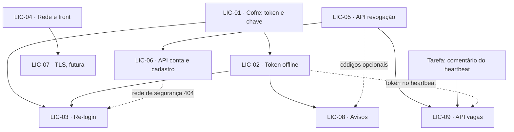

# Specs de `licenca` — StartBig

Especificações das correções de segurança e de re-login da licença. Acordo de decisões: [`docs/licenca/ACORDO.md`](../../docs/licenca/ACORDO.md). Visão do módulo: [`docs/licenca/README.md`](../../docs/licenca/README.md).

Este módulo cruza dois repositórios: `start-big` (backend Python, front Vue e Tauri) e a plataforma StartBig (API NestJS). As specs 05, 06 e 09 são da plataforma. Elas ficam aqui para o planejamento ficar num lugar só (ACORDO D-01), e são implementadas no fork `dzim-almeida/plataformaADM` e entregues por PR ao `aalan-big/plataformaADM`, de onde sai o deploy de produção.

> **Revisão 1 (2026-11-18):** revisão de conflitos (1 a 18). A antiga SPEC-06 foi dividida em LIC-06 e LIC-09; nasceu a LIC-08; a LIC-07 ficou reservada para o TLS.

> **Revisão 2 (2026-11-19):** conferência linha a linha no código da plataforma (conflitos 19 a 30). As specs da API deixaram de estar "bloqueadas por acesso" (fork + PR). Rotas do titular em `/erp/usuario/titular`. Nasceu a ADR-004 (compatibilidade com as versões instaladas do app).

## 1. Mapa das specs

| Spec | Arquivo | Camada | Repositório | Situação | O que entrega |
|------|---------|--------|-------------|----------|---------------|
| LIC-01 | [`SPEC-01-COFRE-LICENCA.md`](./completed/SPEC-01-COFRE-LICENCA.md) | Backend | start-big | Concluída (2026-11-19) | Cofre DPAPI (escopo de máquina) para o token e a chave de ativação; cópia cifrada do backup na nuvem |
| LIC-02 | [`SPEC-02-TOKEN-OFFLINE.md`](./completed/SPEC-02-TOKEN-OFFLINE.md) | Backend | start-big | Concluída (2026-11-19) | Vencimento e carência do token assinado, chave pública recuperada antes dos módulos, relógio, dias da API, heartbeat com token |
| LIC-03 | [`SPEC-03-RE-LOGIN.md`](./SPEC-03-RE-LOGIN.md) | Backend e Frontend | start-big | Backlog | Restauração pelo titular (ciclo pelo `/status`), setup com os dados da nuvem, cadastro `202`, mensagens por código, avisos de troca |
| LIC-04 | [`SPEC-04-REDE-E-FRONT.md`](./SPEC-04-REDE-E-FRONT.md) | Frontend, Backend, NSIS e Tauri | start-big | Backlog | CORS fechado, token do login só na sessão da janela, sem `v-html`, permissões exatas do Tauri, firewall e middleware de rede |
| LIC-05 | [`SPEC-05-API-REVOGACAO.md`](./SPEC-05-API-REVOGACAO.md) | API | plataforma (fork → PR) | Backlog | Revogação no guard, backup só do servidor atual, trial com um backup, vencimento com código |
| LIC-06 | [`SPEC-06-API-CONTA-CADASTRO.md`](./SPEC-06-API-CONTA-CADASTRO.md) | API e painel web | plataforma (fork → PR) | Backlog | Cadastro com resposta única e confirmação, compatível com as versões instaladas; bloqueio de login; reenviar link; tokens por finalidade; titular |
| LIC-07 | — | Rede da loja | start-big | Reservada (fora desta série) | TLS na rede da loja |
| LIC-08 | [`SPEC-08-AVISOS-LICENCA-BACKUP.md`](./SPEC-08-AVISOS-LICENCA-BACKUP.md) | Backend e Frontend | start-big | Backlog | Avisos ao dono: relógio, dias estimados, backup na nuvem parado, pasta aberta |
| LIC-09 | [`SPEC-09-API-VAGAS-SESSOES.md`](./SPEC-09-API-VAGAS-SESSOES.md) | API | plataforma (fork → PR) | Backlog | Sessões de 10 minutos, troca apaga as sessões da loja antiga, vaga com a licença trancada, heartbeat autenticado |

> Spec concluída: o arquivo passa para `./completed/` e a situação vira `Concluída (AAAA-MM-DD)`.

## 2. Dependências

As linhas pontilhadas são dependência de integração, não de código: cada lado funciona sem o outro e passa a aproveitá-lo quando ele chegar (ADR-004). A ordem completa está no [`ROTEIRO-IMPLEMENTACAO.md`](./ROTEIRO-IMPLEMENTACAO.md).

## 3. Roteamento por tarefa

| Preciso... | Spec | Seção |
|------------|------|-------|
| Guardar o token ou a chave de ativação no cofre | LIC-01 | §6.1, §6.2 |
| Saber o que fazer quando o cofre falha | LIC-01 | §6.4 |
| Cifrar o backup que vai para a nuvem | LIC-01 | §6.7 |
| Entender a carência, o vencimento e o relógio offline | LIC-02 | §6.1, §6.5 |
| Ler os módulos com segurança | LIC-02 | §6.3 |
| Mandar o token no heartbeat | LIC-02 | §6.8 |
| Restaurar o banco depois do re-login | LIC-03 | §4.1, §6.1 |
| Mostrar uma mensagem de erro de licença | LIC-03 | §6.4 |
| Abrir o setup com os dados da nuvem | LIC-03 | §6.6 |
| Mexer no token do login no front | LIC-04 | §6.2 |
| Mudar o CORS, o `v-html` ou as permissões do Tauri | LIC-04 | §6.1, §6.3, §6.4 |
| Mexer no firewall ou na rede da loja | LIC-04 | §6.5 |
| Mostrar um aviso ao dono (relógio, backup, pasta) | LIC-08 | §6 |
| Recusar backup de máquina trocada ou mexer no trial | LIC-05 | §6.2, §6.3 |
| Mudar o cadastro ou o login na API | LIC-06 | §6.1, §6.2 |
| Mudar a regra das vagas ou do heartbeat | LIC-09 | §6 |
| Mudar uma resposta da API sem quebrar o app instalado | [ADR-004](../../docs/licenca/adr/ADR-004-compatibilidade-api-app-instalado.md) | §2 |

## 4. Roteamento por arquivo

| Arquivo | Spec que o define ou altera |
|---------|------------------------------|
| `backend-fastapi/app/services/licenca/cofre.py` | LIC-01 |
| `backend-fastapi/app/services/licenca/segredos_licenca.py` | LIC-01 |
| `backend-fastapi/app/services/licenca/validacao.py` | LIC-01, LIC-02 |
| `backend-fastapi/app/services/licenca/sincronizacao.py` | LIC-01, LIC-02 |
| `backend-fastapi/app/services/licenca/relogio.py` | LIC-02 |
| `backend-fastapi/app/services/licenca/cadastro.py` | LIC-01, LIC-03 |
| `backend-fastapi/app/services/licenca/restauracao_titular.py` | LIC-03 |
| `backend-fastapi/app/services/licenca/titular_nuvem.py` | LIC-03 |
| `backend-fastapi/app/services/sistema/setup.py` | LIC-03 |
| `backend-fastapi/app/services/cloud/cifra_backup.py` | LIC-01 |
| `backend-fastapi/app/services/cloud/sync.py` | LIC-01 |
| `backend-fastapi/app/services/cloud/download.py` | LIC-01 |
| `backend-fastapi/app/services/cloud/ultimo_ciclo.py` | LIC-08 |
| `backend-fastapi/app/services/backup/_utils.py` | LIC-01 |
| `backend-fastapi/app/services/backup/restore.py` | LIC-03 |
| `backend-fastapi/app/core/permissoes.py` | LIC-01, LIC-08 |
| `backend-fastapi/app/core/tarefas.py` | LIC-01, LIC-08 |
| `backend-fastapi/app/core/config.py` | LIC-04 |
| `backend-fastapi/app/core/rede_local.py` | LIC-04 |
| `backend-fastapi/app/core/system.py` | LIC-04 |
| `backend-fastapi/app/main.py` | LIC-04 |
| `frontend/src-tauri/nsis/extend/hooks.nsh` | LIC-04 |
| `frontend/src-tauri/capabilities/default.json` | LIC-04 |
| `frontend/src/shared/services/tokenSessao.service.ts` | LIC-04 |
| `frontend/src/api/axios.ts` | LIC-04 |
| `frontend/src/shared/services/licenca.service.ts` | LIC-03, LIC-08 |
| `frontend/src/modules/sign-in/composables/useSignIn.ts` | LIC-03 |
| `frontend/src/shared/components/commons/BaseConfirmModal/BaseConfirmModal.vue` | LIC-04 |
| `frontend/src/modules/configuracoes/components/sections/backup-dados/components/BackupDados.vue` | LIC-08 |
| `apps/server/src/core/guards/erp-licenca.guard.ts` (API) | LIC-05, LIC-09 |
| `apps/server/src/features/erp/erp-backup.service.ts` (API) | LIC-05 |
| `apps/server/src/features/dispositivos/dispositivo.service.ts` (API) | LIC-05, LIC-06, LIC-09 |
| `apps/server/src/features/erp/erp-licenca.controller.ts` (API) | LIC-06, LIC-09 |
| `apps/server/src/features/erp/erp-auth.service.ts` (API) | LIC-06 |
| `apps/server/src/features/erp/erp-usuario.service.ts` (API) | LIC-06 |
| `apps/server/src/core/email/email.service.ts` (API) | LIC-06 |
| `packages/database/src/repositories/licenca-servidor.repository.ts` (API) | LIC-05, LIC-09 |
| `packages/database/src/repositories/licenca-sessao.repository.ts` (API) | LIC-09 |
| `apps/server/src/features/cron/cron.service.ts` (API) | LIC-09 |
| `apps/server/test/apoio/prisma-falso.ts` (API) | LIC-05, LIC-09 |
| `prisma/schema.prisma` (API) | LIC-06 |

## 5. Endpoints

| Método e rota | Permissão | Spec |
|---------------|-----------|------|
| `POST /api/v1/licenca/restaurar-backup` | Pública, com a conta da loja | LIC-03 §4.1 |
| `GET /api/v1/backup/avisos` | Como as outras rotas de backup | LIC-08 §4.1 |
| `POST /erp/auto-cadastro` (API, muda: `202` ou `409`) | Pública | LIC-06 §4.1 |
| `GET /erp/auto-cadastro/confirmar` (API, nova) | Pública, pelo link | LIC-06 §4.2 |
| `POST /erp/auth/login` (API, muda os erros) | Pública | LIC-06 §4.3 |
| `POST /erp/auth/reenviar-link` (API, nova) | Pública | LIC-06 §4.4 |
| `GET /erp/usuario/titular` (API, nova) | Com token da licença | LIC-06 §4.5 |
| `PUT /erp/usuario/titular` (API, nova) | Com token da licença | LIC-06 §4.6 |
| `GET /erp/backup/status`, `url-upload`, `url-download` (API, mudam) | Com token da licença, só do servidor atual | LIC-05 §4.2, §4.4 |
| `POST /licenca/conectar` (API, muda o vencimento para `402`) | Com a chave | LIC-05 §4.5 |
| `POST /licenca/heartbeat` (API, muda: token opcional, com transição) | Token da licença (opcional na transição) | LIC-09 §4.1 |

## 6. Referências

- Acordo de decisões: [`docs/licenca/ACORDO.md`](../../docs/licenca/ACORDO.md)
- ADRs: [`docs/licenca/adr/`](../../docs/licenca/adr/)
- Código da plataforma: fork `https://github.com/dzim-almeida/plataformaADM` (trabalho) e `https://github.com/aalan-big/plataformaADM` (produção)
- Quadro e plano (visões, não fonte): "Quadro da Licença" e "Plano de Correção", nos endereços publicados na sessão de planejamento.
