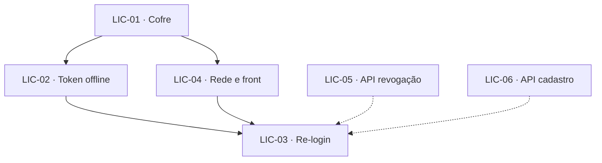

# Specs de `licenca` — StartBig

Especificações das correções de segurança e de re-login da licença. Acordo de decisões: [`docs/licenca/ACORDO.md`](../../docs/licenca/ACORDO.md). Visão do módulo: [`docs/licenca/README.md`](../../docs/licenca/README.md).

Este módulo cruza dois repositórios: `start-big` (backend Python, front Vue e Tauri) e `plataformaADM` (API NestJS). As specs 05 e 06 são da API. Elas ficam aqui para o planejamento ficar num lugar só (ACORDO D-01).

## 1. Mapa das specs

| Spec | Arquivo | Camada | Repositório | Situação | O que entrega |
|------|---------|--------|-------------|----------|---------------|
| LIC-01 | [`SPEC-01-COFRE-LICENCA.md`](./SPEC-01-COFRE-LICENCA.md) | Backend | start-big | Backlog | Cofre pela DPAPI, token cifrado, backup cifrado e sem token |
| LIC-02 | [`SPEC-02-TOKEN-OFFLINE.md`](./SPEC-02-TOKEN-OFFLINE.md) | Backend | start-big | Backlog | Carência e prazos do token assinado, relógio que voltou, dias da API |
| LIC-03 | [`SPEC-03-RE-LOGIN.md`](./SPEC-03-RE-LOGIN.md) | Backend e Frontend | start-big | Backlog | Restauração pelo titular, escolha depois do re-login, avisos de troca |
| LIC-04 | [`SPEC-04-REDE-E-FRONT.md`](./SPEC-04-REDE-E-FRONT.md) | Frontend, Backend e Tauri | start-big | Backlog | CORS fechado, token do login no servidor, sem `v-html`, permissões do Tauri |
| LIC-05 | [`SPEC-05-API-REVOGACAO.md`](./SPEC-05-API-REVOGACAO.md) | API | plataformaADM | Backlog · bloqueada por acesso | Revogação no guard, backup só do servidor atual, trial com um backup |
| LIC-06 | [`SPEC-06-API-CADASTRO-SESSOES.md`](./SPEC-06-API-CADASTRO-SESSOES.md) | API | plataformaADM | Backlog · bloqueada por acesso | Cadastro com confirmação, bloqueio de login, sessões de 10 minutos |

> Spec concluída: o arquivo passa para `./completed/` e a situação vira `Concluída (AAAA-MM-DD)`.

## 2. Dependências

A linha pontilhada significa dependência de integração, não de código: a LIC-03 funciona sem a API nova, com os textos antigos de erro. A ordem completa está no [`ROTEIRO-IMPLEMENTACAO.md`](./ROTEIRO-IMPLEMENTACAO.md).

## 3. Roteamento por tarefa

| Preciso... | Spec | Seção |
|------------|------|-------|
| Guardar o token cifrado | LIC-01 | §6.2 |
| Fazer o backup sair sem token e cifrado | LIC-01 | §6.4 |
| Entender a carência e o relógio offline | LIC-02 | §6.1, §6.5 |
| Restaurar o banco depois do re-login | LIC-03 | §4.1, §6.1 |
| Mudar o CORS ou o `v-html` | LIC-04 | §6.1, §6.3 |
| Recusar backup de máquina trocada | LIC-05 | §6.2 |
| Mudar o cadastro na API | LIC-06 | §6.1 |

## 4. Roteamento por arquivo

| Arquivo | Spec que o define ou altera |
|---------|------------------------------|
| `backend-fastapi/app/services/licenca/cofre.py` | LIC-01 |
| `backend-fastapi/app/services/licenca/token_local.py` | LIC-01 |
| `backend-fastapi/app/services/licenca/validacao.py` | LIC-01, LIC-02 |
| `backend-fastapi/app/services/licenca/relogio.py` | LIC-02 |
| `backend-fastapi/app/services/licenca/restauracao_titular.py` | LIC-03 |
| `backend-fastapi/app/services/backup/local.py` | LIC-01 |
| `backend-fastapi/app/services/backup/restore.py` | LIC-01, LIC-03 |
| `backend-fastapi/app/api/v1/endpoints/sessao.py` | LIC-04 |
| `backend-fastapi/app/main.py` | LIC-04 |
| `frontend/src/api/axios.ts` | LIC-04 |
| `frontend/src/modules/sign-in/composables/useSignIn.ts` | LIC-03 |
| `frontend/src/shared/components/commons/BaseConfirmModal/BaseConfirmModal.vue` | LIC-04 |
| `frontend/src-tauri/capabilities/default.json` | LIC-04 |
| `apps/server/src/core/guards/erp-licenca.guard.ts` (API) | LIC-05 |
| `apps/server/src/features/erp/erp-backup.service.ts` (API) | LIC-05 |
| `apps/server/src/features/dispositivos/dispositivo.service.ts` (API) | LIC-05, LIC-06 |

## 5. Endpoints

| Método e rota | Permissão | Spec |
|---------------|-----------|------|
| `POST /api/v1/licenca/restaurar-backup` | Pública, com a conta da loja | LIC-03 §4.1 |
| `GET`, `PUT`, `DELETE /api/v1/sessao/token-erp` | Só na própria máquina | LIC-04 §4.2 |
| `POST /erp/auto-cadastro` (API, muda) | Pública | LIC-06 §4.1 |
| `GET /erp/auto-cadastro/confirmar` (API, nova) | Pública, pelo link | LIC-06 §4.2 |
| `POST /erp/auth/reenviar-primeiro-acesso` (API, nova) | Pública | LIC-06 §4.4 |
| `POST /licenca/desconectar` (API, muda) | Com token de sessão | LIC-06 §4.5 |

## 6. Referências

- Acordo de decisões: [`docs/licenca/ACORDO.md`](../../docs/licenca/ACORDO.md)
- ADRs: [`docs/licenca/adr/`](../../docs/licenca/adr/)
- Quadro e plano (visões, não fonte): "Quadro da Licença" e "Plano de Correção", nos endereços publicados nesta sessão.
